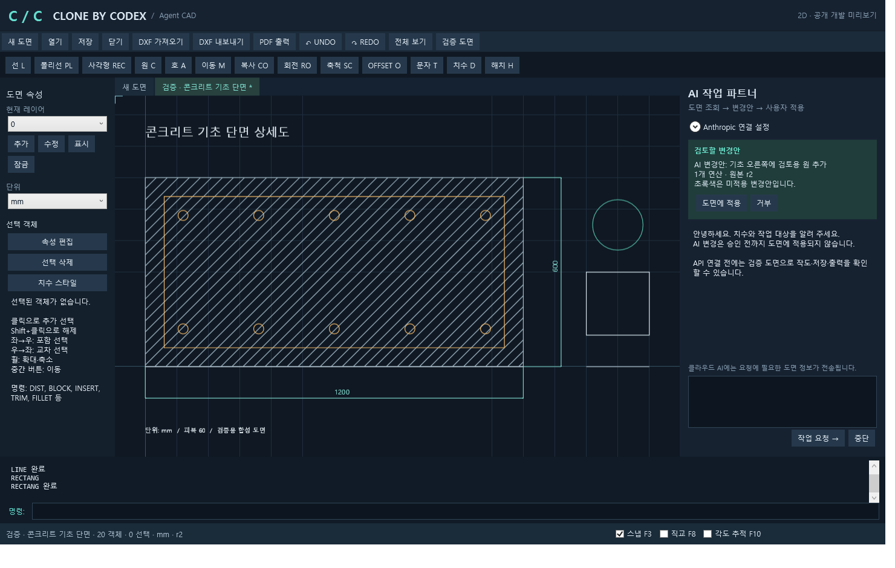
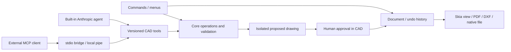

# Clone by Codex — Agent CAD

An open-source Windows CAD where people and AI agents use the same editing engine.
Korean interface, English drafting commands, local drawing files, and human-approved AI changes.

[한국어 시작 안내](docs/START.ko.md) · [Contributing](CONTRIBUTING.md) · [Agent tools](docs/AGENT_API.md) · [Roadmap](docs/ROADMAP.md)

**Status: 0.1 developer preview.** This is an independent implementation inspired by familiar CAD workflows, with no Autodesk code or affiliation. It is not an AutoCAD-compatible replacement. Review imported geometry and plotted output before using real drawings.



## Run

Target: Windows 11 x64. Development smoke tests currently run on Windows 10 22H2; a clean Windows 11 installation test is outstanding.

Install the .NET 10 SDK, then in PowerShell:

```powershell
./scripts/build.ps1
./scripts/run.ps1
```

The Windows release bundle includes the runtime. Run `Install.cmd` to install for the current user, or run `app/CloneCad.Desktop.exe` directly. No server, account, or AI connection is needed for drafting.

## Available now

- Lines, polylines, rectangles, circles, center/start/end arcs; absolute, relative and polar input.
- Move, copy, rotate, uniform scale, mirror, line/polyline/circle offset, line-based trim/extend/fillet/chamfer, line/polyline stretch, rectangular/polar arrays, join and explode.
- Layers, colors, basic continuous/dashed/center lines, lineweights and object property editing.
- Windows-font Korean text; aligned, linear, angular, radius and diameter dimensions; common dimension settings; simple blocks; single-boundary SOLID/ANSI31 hatches.
- Associative dimensions for linked source lines/circles, linked polygon hatches, atomic undo/redo and native `.cbcad` files.
- Multiple drawing tabs, five-minute recovery snapshots and abnormal-exit recovery.
- DXF R2013 ASCII export; supported planar entities imported through ACadSharp. Unsupported entities and font/linetype substitutions are reported before partial import.
- A4–A0 vector PDF, explicit scale, monochrome/color, region clipping and print preview.
- Anthropic-powered built-in drafting assistant, replaceable provider interface and MCP stdio bridge. Eight versioned tools expose exact geometry, measurements, proposed transactions and rendered previews.
- AI changes remain isolated until approved in the CAD UI. One undo reverses an approved batch. There is no remote approval tool.

Open **검증 도면** for a synthetic concrete foundation section. `Esc` cancels a command, Enter repeats the last command, F3 toggles object snaps, F8 orthographic drawing, F10 polar tracking. Wheel zooms and middle drag pans. Drag left-to-right for window selection, right-to-left for crossing selection.

Example command entries:

```text
RECTANG 0,0 600,900
CIRCLE 300,450 50
LINE 0,0 @100,0
TEXT 0,950 20 기초 단면
```

`LINE` currently creates one segment per invocation. `PLINE` accepts repeated points, then Enter to finish or `C` to close. Commands prompt for further parameters; click geometry or type coordinates. Select target objects before editing, or select them when prompted and press Enter. `TRIM`/`EXTEND` use selection order: target line, then boundary line.

## Agent setup

Expand **Anthropic 연결 설정**, enter your own API key and an available tool-capable model ID, then save. Keys are stored in Windows Credential Manager; the model ID alone is saved in settings. API usage is billed by the provider. Necessary drawing information and requested preview images are sent to that provider.

Try: `폭 600mm, 높이 900mm 사각형을 그리고 중심에 지름 100mm 원을 만들어줘.`

Green overlay represents proposed additions/changes; red marks proposed deletions. Apply or reject in the CAD UI. A stale proposal cannot be applied. Cloud errors do not edit the live drawing. Live Anthropic calls have not yet been verified with a user key; automated tests exercise the provider/tool loop using scripted responses.

For external agents, click **외부 에이전트 연결 정보 복사** in the connection panel and paste the MCP configuration into your client. It binds to this running CAD instance; copy it again after restarting CAD. Only same-user local named pipes are supported.

## Current limits

- Native save preserves association metadata; DXF import does not restore source dimension/hatch associations.
- Curved/bulged polylines, tilted/3D entities, dynamic/attribute/nonuniform blocks, multi-loop or curved-boundary hatches, SHX fonts, rich MTEXT formatting and arbitrary linetype patterns are not faithfully supported. Import reports unsupported entities; some text/style features are simplified.
- Trim/extend/fillet/chamfer operate on two straight lines. Stretch operates on line/polyline vertices. Block mirror requires exploding first. There is no sketch constraint solver.
- Join requires connected endpoints. Offset is a basic miter algorithm, not a general polygon topology engine; inspect concave/self-intersecting results.
- No DWG, layouts/viewports, xrefs, AutoLISP, 3D, remote service or runtime plugin installation yet.
- Hard limit: 100,000 entities per drawing; validation target: 10,000. Skia engine benchmarks do not establish interactive WPF performance on other machines.
- Unsigned preview distribution; no automatic updates. Keep independent backups while evaluating it.

See [verification](docs/VERIFICATION.md) for what was actually tested and what remains.

## Architecture



The core has no WPF, provider or DXF dependency. Compiled-in operations can be contributed through `ICadOperation`; transactions, validation, previews and undo stay shared. See [the extension example](examples/ADD_OPERATION.md).

## Build and verify

```powershell
./scripts/build.ps1
./scripts/verify.ps1
./scripts/package.ps1
```

The verification script runs tests, a hidden WPF command/transaction smoke test, and exports synthetic native/DXF/PDF/PNG artifacts. No API key or network AI call is used. A GitHub Actions template for these checks is provided at `docs/ci/windows.yml`; it is not active because the publishing credential lacks GitHub's `workflow` scope. A maintainer with that permission can place it under `.github/workflows/windows.yml`.

MIT licensed. Dependency notices and bundled NuGet license metadata are distributed with the package. Contributions to drawing accuracy, agent interoperability, tests, documentation and usability are welcome.
